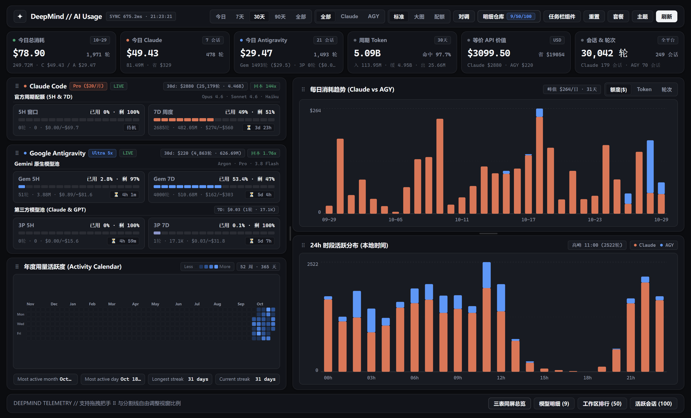
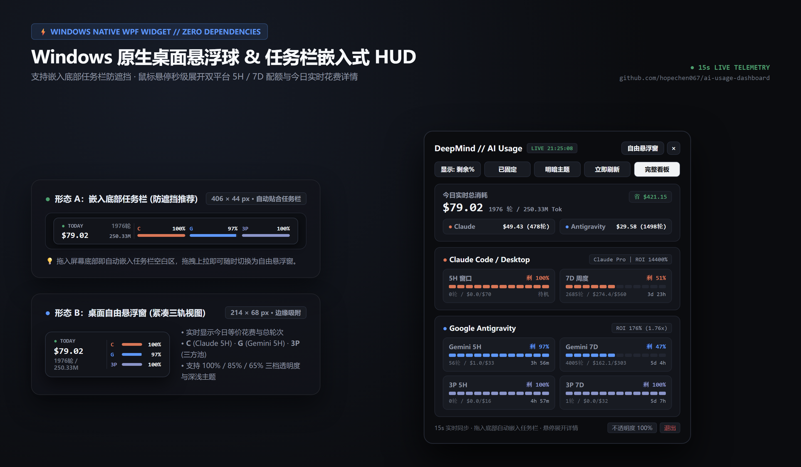
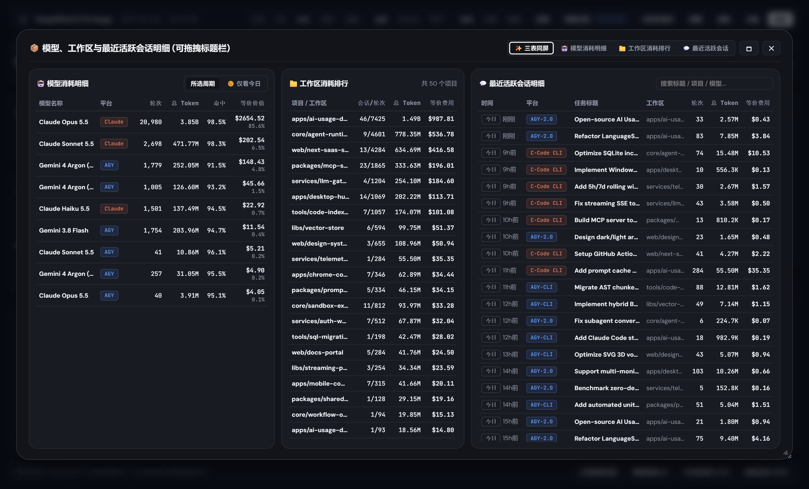
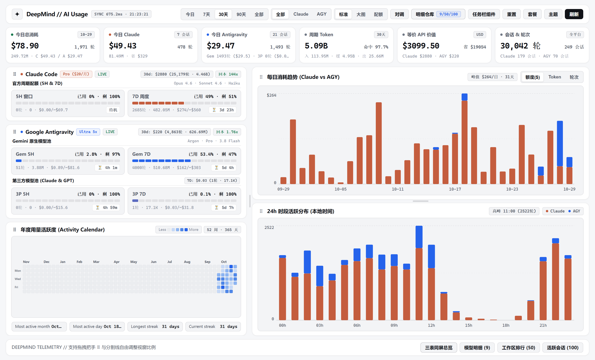

# AI Usage & Quota Global Dashboard (`ai-usage-dashboard`)

> **零外部依赖 (Zero-Dependency)** 的 **Claude Code / Claude Desktop** 与 **Google Antigravity** 全局 Token 消耗、API 等价成本、30 天订阅回本率（ROI）看板 + **Windows 原生桌面悬浮球 / 任务栏嵌入式 HUD**。


---

## 📸 界面预览 (Screenshots)

### 1. 全局实时仪表盘（深色模式）


### 2. Windows 原生任务栏嵌入式胶囊 & 桌面悬浮球 HUD


### 3. 模型消耗、工作区排行与活跃会话三表同屏明细


<details>
<summary>🌞 <b>点击展开：浅色主题看板预览 (Light Mode)</b></summary>
<br/>



</details>

---

## ✨ 核心特性 (Features)

1. **双平台全自动本地扫描（零配置即插即用）**
   - **Claude Code / Claude Desktop**：自动扫描 `~/.claude/projects` 下的 `.jsonl` 会话日志，按 `message.id` 精准去重，支持主会话与 Subagent 自动归并。
   - **Google Antigravity**：自动扫描 `~/.gemini/antigravity*`（支持 Antigravity 2.0、CLI、IDE）下的 `brain/*/transcript.jsonl` 与内置 SQLite `conversation_summaries.db`（使用 Node 22 原生 `node:sqlite` 读取，无需编译任何 C++ 依赖）。
2. **官方实时配额直连与周期对齐 (Official Live Quota Sync)**
   - **Antigravity 双池配额直连**：自动探测本地运行中的 Antigravity `language_server` RPC 接口（`GetUserStatus` & `RetrieveUserQuotaSummary`），实时同步 **Gemini 模型池 (5h / 7d)** 与 **第三方 Claude & GPT 模型池 (5h / 7d)** 的官方剩余百分比与精确重置时间（`resetTime`）。
   - **Claude 官方配额校准**：支持直连 Claude Desktop 本地 `plan-usage-history.json` 采样历史以及 Claude Code `statusLine` 实时 Hook，自动推算并校准 5 小时与 7 天滚动窗口的重置边界与等价美元预算。
3. **今日实时统计 & 30 天订阅回本率 (ROI) 分析**
   - 独立展示 **今日（00:00 起）** 的实时花费、对话轮数、活跃会话数、模型分布与缓存节省金额。
   - 内置各主流模型（Claude Opus / Sonnet / Haiku / Fable、Gemini 4 Argon High/Med/Low、Gemini 3 Pro/Flash、GPT-OSS 120B）的官方 Token 定价与缓存命中折算，直观计算 \$20 / \$100 / \$125 / \$200 / \$250 等各档订阅套餐的 **30 天等价 API 价值与回本倍数 (ROI)**。
4. **Windows 原生桌面悬浮球 & 任务栏嵌入式胶囊 (WPF HUD)**
   - 提供纯 PowerShell + WPF 编写的轻量级桌面监控组件（`src/floating-ball.ps1`），支持：
     - **任务栏无缝嵌入模式**（防遮挡推荐，支持拖拽贴合底部任务栏）与 **自由悬浮球模式**。
     - 鼠标悬停/点击展开 **完整 HUD 详情面板**（涵盖今日总消耗、Claude 5H/7D、Gemini 5H/7D、3P 5H/7D 进度条与倒计时）。
     - 支持明暗主题切换、三档不透明度调节、剩余%/已用%切换、系统托盘菜单及单实例唤醒。
5. **极速增量缓存**
   - 基于文件 `mtimeMs` + `size` 的增量解析缓存，首次全量扫描后毫秒级响应。
   - 所有个人配额与缓存数据均保存在本地 `data/` 目录（已默认加入 `.gitignore`，绝不上传云端）。

---

## 🚀 快速开始 (Quick Start)

### 环境要求
- **Node.js `>= 22.0.0`**（使用了 Node 22 内置的 `node:sqlite` 模块，无需 `npm install` 任何第三方包）
- Windows 10 / 11（若需使用原生桌面悬浮球 / 任务栏 HUD；Web 仪表盘与 CLI 支持全平台）

### 1. 克隆仓库
```bash
git clone https://github.com/hopechen067/ai-usage-dashboard.git
cd ai-usage-dashboard
```

### 2. 启动 Web 仪表盘
```bash
# 启动服务并自动在浏览器打开 http://127.0.0.1:4321
npm run open

# 或仅启动后台服务
npm start
```
> **Windows 用户快捷方式**：直接双击根目录下的 **`启动仪表盘.bat`** 即可一键启动并打开浏览器看板。

### 3. 启动 Windows 桌面悬浮球 / 任务栏胶囊
```bash
# 启动后端服务并同时唤起 Windows 桌面悬浮球
npm run widget
```
> **Windows 用户快捷方式**：
> - 直接双击 **`启动悬浮球.exe`**（无黑框原生启动器）或 **`启动悬浮球.bat`**。
> - 若悬浮球运行时后台服务尚未启动，悬浮球会自动在后台静默拉起 `src/server.mjs`。

### 4. 终端 CLI 速览模式
无需打开浏览器，直接在终端打印漂亮的全局统计报表：
```bash
# 默认查看近 30 天 + 今日实时统计 + 实时配额池状态
npm run cli

# 查看今日统计
node src/cli.mjs today

# 查看全部历史统计
node src/cli.mjs all
```

---

## 🔗 可选：配置 Claude Code StatusLine 实时 Hook

如果你希望在 Claude Code CLI 底部状态栏实时显示当前模型、5h/7d 配额与花费，并将官方 `rate_limits` 实时推送给本仪表盘，可在 `~/.claude/settings.json` 中添加：

```json
{
  "statusLine": {
    "type": "command",
    "command": "node \"/path/to/ai-usage-dashboard/src/hook-receiver.mjs\" --claude-statusline"
  }
}
```
*(Web 仪表盘页面底部也提供了一键复制当前机器绝对路径配置的功能。)*

---

## 📁 目录结构 (Project Structure)

```text
ai-usage-dashboard/
├── docs/
│   └── screenshots/            # README 预览截图
├── public/
│   ├── index.html              # 单文件响应式 Web 仪表盘 (支持深浅色主题、年度热力图、趋势图、明细表)
│   └── voxel-orb.ico           # 多尺寸 Voxel HUD 图标
├── src/
│   ├── server.mjs              # 零依赖 HTTP API 与静态资源服务 (默认端口 4321)
│   ├── collector.mjs           # 核心日志扫描、SQLite 解析、LanguageServer RPC 探测与配额对齐引擎
│   ├── pricing.mjs             # 模型 Token 定价表、缓存节省计算与订阅套餐预算定义
│   ├── cli.mjs                 # 命令行终端报表工具
│   ├── hook-receiver.mjs       # Claude Code statusLine & Antigravity 生命周期 Hook 接收器
│   ├── floating-ball.ps1       # Windows WPF 原生桌面悬浮球 / 任务栏嵌入式胶囊组件
│   ├── floating-ball-ui.json   # 悬浮球界面文案配置
│   └── build-icon.ps1          # 图标与无窗口启动器 (启动悬浮球.exe) 生成脚本
├── data/                       # [Git 忽略] 本地运行时生成的缓存、用户设置与实时配额快照
├── 启动仪表盘.bat               # Windows 一键启动 Web 看板脚本
├── 启动悬浮球.bat               # Windows 一键启动桌面悬浮球脚本
├── 启动悬浮球.exe               # Windows 原生无黑框悬浮球启动程序
└── package.json
```

---

## 🔒 隐私与安全说明 (Privacy)

- **100% 本地运行**：本项目仅监听 `127.0.0.1:4321`，不向任何外部服务器发送任何遥测或统计数据。
- **敏感数据隔离**：本地扫描生成的 `data/parsed_cache.json`、`data/live_quota.json`、`data/settings.json` 与 `data/widget_state.json` 已在 `.gitignore` 中严格排除，确保你的工作区路径、会话标题与账号信息只保留在本地机器。

---

## 📄 开源协议 (License)

本项目基于 [MIT License](./LICENSE) 开源。
